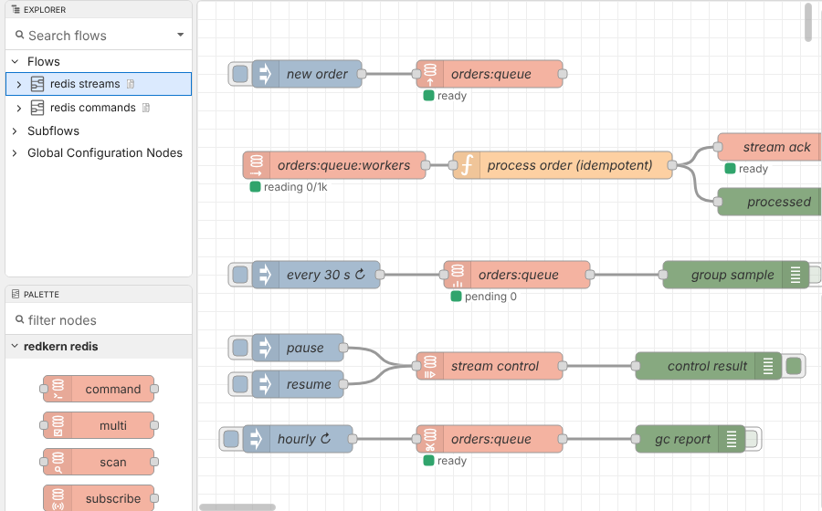

# @redkern/node-red-redis

Production Redis palette for Node-RED: arbitrary commands, transactions, scans, Pub/Sub, a transitional list queue and Redis Streams consumer groups with at-least-once delivery, a dead-letter stream, backpressure and Kubernetes rollout control. Part of the [redkern](https://github.com/redkern) palette family, built on [`@redkern/node-red-kit`](https://www.npmjs.com/package/@redkern/node-red-kit). Replaces `@yroshcha/node-red-contrib-redis-full`.



## Requirements

- Node.js 22 or newer
- Node-RED 4.1 or 5.x
- Redis 6.2 or newer, or Valkey 7.2 or newer (Redis 7 recommended: `XAUTOCLAIM` reports deleted entries). Tested locally on Redis 7.0 and 8.0 and Valkey 7.2 and 8.1; CI also runs Redis 6.2.

## Install

```sh
npm install @redkern/node-red-redis
```

The package registers 13 node types in the **redkern redis** category . It installs side by side with `@yroshcha/node-red-contrib-redis-full`: types, routes and settings do not overlap.

## Nodes

| Node | Type | What it does |
| --- | --- | --- |
| redis (config) | `redkern-redis-config` | Standalone or Cluster connection, shared by the nodes that use it |
| [command](#command) | `redkern-redis-command` | One command on the shared connection, with denylist |
| [multi](#multi) | `redkern-redis-multi` | MULTI/EXEC transaction |
| [scan](#scan) | `redkern-redis-scan` | Full SCAN/HSCAN/SSCAN/ZSCAN walk with limit and timeout |
| [subscribe](#subscribe) | `redkern-redis-subscribe` | Pub/Sub channels and patterns |
| [list in](#list-in) | `redkern-redis-list-in` | BLPOP/BRPOP intake for list queues (transitional) |
| [stream in](#stream-in) | `redkern-redis-stream-in` | Consumer group reader, at-least-once |
| [stream out](#stream-out) | `redkern-redis-stream-out` | XADD |
| [stream ack](#stream-ack) | `redkern-redis-stream-ack` | XACK, single or batch |
| [stream claim](#stream-claim) | `redkern-redis-stream-claim` | Manual XAUTOCLAIM |
| [stream gc](#stream-gc) | `redkern-redis-stream-gc` | Removes idle consumers with an empty PEL |
| [stream metrics](#metrics) | `redkern-redis-stream-metrics` | Group sample: PEL, lag, consumers, DLQ length |
| [stream control](#control) | `redkern-redis-stream-control` | pause, resume, drain, status of stream in nodes |

Examples are in [`examples/`](examples) and appear in the Node-RED import menu.

## Message contract

Every node writes its metadata only under `msg.redkern.redis` and never replaces `msg.redkern` or another palette's key, so a kafka → redis flow keeps both `msg.redkern.kafka` and `msg.redkern.redis`.

stream in sends:

```js
msg.payload        // entry fields; JSON objects and arrays written by stream out are restored
msg.redkern.redis = { stream, group, id, consumer, deliveries }
// with batching: payload, id and deliveries are arrays of the same length
```

`legacyMsgFields` additionally sets the fields of the legacy palette (`msg.streamId`, `msg.stream`, `msg.group`, `msg._streamKey`, `msg._streamGroup`, `msg.consumer`, and `msg.scanComplete`, `msg.acked` on the other nodes). Turn it on for a migrated node when the flow still reads those fields; new nodes keep it off.

## <a id="config"></a>Connection

Host, port, username and timeouts are set in the config node in the flow. When a value has to come from the environment, write `${VAR}` in the field: Node-RED resolves it, the flow in Git still shows where the value comes from, and two config nodes can point at different Redis servers. An unresolved `${VAR}` stops the node with `ENV_UNRESOLVED`. The password is a credential.

Connections per pod:

```
connections = configs × 1 (shared)
            + configs with subscribe nodes × 1 (subscriber)
            + stream in nodes + list in nodes (blocking, one each)
```

The live numbers are in the config dialog (Reliability tab, needs `adminAuth`) and in `redkern_redis_connections{role}`. While the legacy and the new palette run side by side during migration, each has its own config nodes, so the count doubles: check `maxclients` before you start.

TLS always verifies the server certificate against the system CAs; there is no option to turn verification off. A private CA is added to the Node.js process with `NODE_EXTRA_CA_CERTS`. When the certificate is issued for a name other than the host you connect to (for example an IP or a NAT address), set **TLS server name**. A rejected certificate gives a red status with the TLS error code instead of endless retries. In cluster mode the certificate of every node is checked against the address the cluster announces, so it must carry that hostname or IP; this is the case for AWS ElastiCache and MemoryDB.

Cluster mode uses database 0. A stream and its DLQ must share a hash tag, for example `orders:{eu}` and `orders:{eu}:dlq`; otherwise stream in stops on start with `DLQ_CROSS_SLOT`.

### <a id="acl"></a>Redis ACL

Tested minimal ACL for the palette's own operations plus ordinary data commands of command and multi (Redis 7, Valkey 7.2):

```
ACL SETUSER node-red on >PASSWORD ~* &* +@read +@write +@stream +@list +@pubsub +@transaction +@connection +eval +evalsha -@dangerous +info
```

- In cluster mode add `+cluster|slots +cluster|info`; ioredis needs them to discover the topology.
- `+info` is optional: without it ioredis skips its ready check and logs one warning per connection.
- With list in, add `+client|unblock` (it is in `@dangerous`): on close the node ends its own BLPOP at once, so an element popped at that moment is pushed back. Without it close waits up to 1.5 s for the pop.
- Narrow `~*` and `&*` to the key and channel prefixes of your flows. stream in also writes the DLQ (`<stream>:dlq` by default) and stream gc runs a Lua script through `EVAL`.
- The suite runs against both `+@all -@dangerous` and this list: `REDIS_USERNAME=... REDIS_PASSWORD=... npm run test:integration`.

## <a id="command"></a>command, multi, scan

- command takes the command from the node (`HGET`, `XINFO STREAM`) and arguments from `msg.args`. `msg.command` (string or token array) is used only with **Allow msg.command**, which is off by default.
- The denylist rejects `FLUSHALL`, `FLUSHDB`, `CONFIG`, `SHUTDOWN`, `DEBUG`, `MODULE`, `ACL`, `REPLICAOF`, `SLAVEOF`, `MIGRATE` and `SCRIPT FLUSH`, and commands with the same blast radius: `SWAPDB`, `FAILOVER`, `SAVE`, `BGSAVE`, `BGREWRITEAOF`, `FUNCTION FLUSH/DELETE/RESTORE`, `CLIENT KILL/PAUSE/UNBLOCK` and the admin subcommands of `CLUSTER`. It applies inside multi too and is disabled only by an explicit checkbox.
- Scripts (`EVAL`, `EVALSHA`, `FCALL`, `FUNCTION`, `SCRIPT`) are rejected when the command comes from `msg.command` or `msg.commands`: `EVAL "return redis.call('FLUSHALL')" 0` would bypass the denylist. Set `EVAL` as the command of the node and pass the script and keys in `msg.args` instead.
- Blocking commands (`BLPOP`, `WAIT`, `XREADGROUP … BLOCK`, `SUBSCRIBE`…) and commands that change the shared connection (`CLIENT REPLY`, `CLIENT TRACKING`, `CLIENT SETNAME`, `HELLO`, `AUTH`, `READONLY`) are always rejected: one of them would stall or break every node on the config.
- The denylist is a guard against mistakes, not a security boundary. Give the palette a Redis ACL user with only what it needs (see [Redis ACL](#acl)).
- command, multi and stream out run up to **Concurrency** messages at once (default 64) with **Max queue** waiting (default 10 000); a full queue fails with `INPUT_QUEUE_FULL`, a message that waited more than 30 s for the connection fails with `NODE_NOT_READY`. With concurrency above 1 the order of results is not guaranteed; set 1 when order matters.
- **Send errors to a separate output** moves errors from Catch to an extra last output labelled `error`. Use it in high-rate flows, where a Redis outage would otherwise flood Loki.
- scan walks the cursor until the end, **Max results** or **Timeout (ms)**; in cluster mode SCAN visits every master. `msg.redkern.redis.scan` tells whether the result is complete.

## <a id="subscribe"></a>subscribe

Pub/Sub only: SUBSCRIBE or PSUBSCRIBE. All subscribe nodes of one config node share one subscriber connection, and subscriptions are restored after a reconnect.

## <a id="list-in"></a>list in

A transitional node for queues on lists, with the semantics of the legacy subscribe node in BLPOP/BRPOP mode: popping removes the element. It is deprecated as soon as the queues move to Streams; there is no reliable BLMOVE mode.

**Prefetch** limits elements in the flow at once. `1` (default) pops the next element only after the previous message completed in the flow (tracked through the Node-RED `onComplete` hook); `0` is unlimited, the legacy behaviour: set it on list in nodes that replace a legacy subscribe. A message that never completes frees its slot after **Release timeout**.

## <a id="stream-in"></a>stream in: at-least-once

- The group is created with `MKSTREAM` on start and restored if it disappears (`NOGROUP`).
- **ACK manual** (default) keeps every entry in the PEL until stream ack. **ACK auto** acknowledges right after sending and is at-most-once.
- On start, after an error and after a lost reply the node reads its own PEL through a cursor: from `0`, then from the last ID received, until an empty reply, then switches to `>`. Entries the flow is still processing are kept in an in-flight registry and are not sent again, also across a redeploy of the node.
- After its own recovery the node reclaims entries of dead consumers with `XAUTOCLAIM` every **Reclaim interval**, keeping the cursor between calls.
- An entry delivered more than **Max deliveries** times moves to the DLQ (`<stream>:dlq` by default) with `XADD` and `XACK` in one `MULTI`. Delivery counts are read with one range `XPENDING` per batch. DLQ records keep the legacy fields: `sourceStream`, `sourceGroup`, `sourceId`, `consumer`, `deliveries`, `payload`.
- **Backpressure** stops reading when the PEL reaches **Max pending**: the own PEL of this consumer (default) or the PEL of the whole group.
- **Batch window**, **Read count**, **Rate limit** and **Read interval** keep the semantics of the legacy node.
- **Start paused** creates the group but reserves no work until resume, for Kubernetes rollouts.

### Idempotency is required

At-least-once means an entry can arrive again:

- after a pod crash, when another pod reclaims it with `XAUTOCLAIM`;
- when processing one message takes longer than **Reclaim idle** (default 60 s), because another consumer may take the entry meanwhile.

Set **Reclaim idle** above the slowest processing time and make downstream processing idempotent, for example by keying side effects on `msg.redkern.redis.id`. `redkern_redis_redeliveries_total` counts repeated deliveries. Only pause/resume and a regular redeploy are free of duplicates.

The default consumer name is `<pod name>-<node id>` (`os.hostname()` in Kubernetes), the same as in the legacy palette, so consumer names do not change after migration. A custom **Consumer** must stay unique per pod (for example `${HOSTNAME}-orders`): with one fixed name for every HPA pod, each pod treats the others' in-flight entries as its own, resends them on recovery, and drain never sees an empty PEL.

## <a id="stream-out"></a>stream out, <a id="stream-ack"></a>stream ack, <a id="stream-claim"></a>stream claim, <a id="stream-gc"></a>stream gc

- stream out writes a flat `msg.payload` object; nested values become JSON, as before. The new ID goes to `msg.redkern.redis.xadd`, leaving the entry metadata of stream in intact, so stream in → stream out → stream ack still acknowledges the original entry. `MAXLEN` needs the explicit **Allow trimming** option.
- stream ack takes `id` (string or array), `stream` and `group` from `msg.redkern.redis`, then from the legacy fields, then from its own configuration. A batch is acknowledged with one `XACK`. **XDEL after ACK** deletes after a successful ACK. By default the node has no output; **Pass the message on** adds one.
- stream claim runs `XAUTOCLAIM` on demand for manual recovery flows.
- stream gc deletes consumers idle longer than **Min idle** whose PEL is empty. The PEL check and `XGROUP DELCONSUMER` run in one Lua script. Automatic `XTRIM` is out of scope.

## <a id="metrics"></a>Metrics

The palette keeps its own registry in Prometheus text 0.0.4 and announces it through kit while at least one stream metrics node exists:

- with `@redkern/node-red-prometheus` the metrics appear in its `/metrics`;
- without it they are served on the internal port: `GET http://<pod>:9551/redkern/redis/metrics` with `Authorization: Bearer $REDKERN_REDIS_METRICS_TOKEN`. Without the token this route does not exist.

| Metric | Type | Labels |
| --- | --- | --- |
| `redkern_redis_connections` | gauge | `role` |
| `redkern_redis_delivered_total` | counter | `stream`, `group` |
| `redkern_redis_redeliveries_total` | counter | `stream`, `group` |
| `redkern_redis_acked_total` | counter | `stream`, `group` |
| `redkern_redis_dead_letter_total` | counter | `stream`, `group` |
| `redkern_redis_consumer_paused`, `redkern_redis_consumer_inflight` | gauge | `stream`, `group`, `node` |
| `redkern_redis_stream_pending`, `_lag`, `_consumers`, `_dead_letter_length` | gauge | `stream`, `group` (last stream metrics sample) |

`_lag` is the estimate from `XINFO GROUPS` (Redis 7+, empty on 6.2). After a failover or `XDEL` Redis may report it as unknown or let it drift for a while; for HPA and alerts prefer `_pending`.

## <a id="control"></a>Control and Kubernetes

`pause`, `resume`, `drain` and `status` act on every stream in node of the runtime, optionally filtered by `stream`, `group` or `nodeId`:

| Where | Route | Access |
| --- | --- | --- |
| stream control node | `msg.payload = { action, stream?, group?, nodeId?, drainTimeoutMs? }` | flow |
| Admin API | `GET /redkern/redis/streams/status` | `redkern.redis.read` |
| Admin API | `POST /redkern/redis/streams/control` (JSON body) | `redkern.redis.write` |
| Admin API | `GET /redkern/redis/connections` | `redkern.redis.read` |
| Internal port 9551 | `POST /redkern/redis/streams/drain` | loopback only, no token; `REDKERN_REDIS_DRAIN_TOKEN` when the metrics token is set |
| Internal port 9551 | `GET /redkern/redis/metrics` | `REDKERN_REDIS_METRICS_TOKEN` |

Admin routes need `adminAuth`: without it they answer 503 `ADMIN_AUTH_REQUIRED` and the palette logs why once; with it they answer 401 without a valid token. Errors carry a code and a request ID, never internal messages.

`drain` stops reading new entries, sends entries already reserved and waits up to `drainTimeoutMs` for an empty own PEL. It answers `200` with `drained: true`, or `504` with `drained: false`. The internal port listens only while stream in nodes exist and the palette is enabled.

### Helm values

The preStop hook calls the drain route with Node.js itself, so the image needs no curl. It exits 0 when the port is closed on purpose (`REDKERN_REDIS_ENABLED=false` or no stream in nodes) and non-zero when drain times out, so a failed drain is visible in events.

```yaml
env:
  - name: REDKERN_REDIS_ENABLED
    value: "true"
  - name: REDKERN_REDIS_METRICS_TOKEN      # only without the prometheus palette
    valueFrom: { secretKeyRef: { name: node-red-redis, key: metrics-token } }
  - name: REDKERN_REDIS_DRAIN_TOKEN        # required together with METRICS_TOKEN, see below
    valueFrom: { secretKeyRef: { name: node-red-redis, key: drain-token } }
  - name: UV_THREADPOOL_SIZE
    value: "16"
terminationGracePeriodSeconds: 45          # > drainTimeoutMs (30 s) + 10 s kit close budget
lifecycle:
  preStop:
    exec:
      command:
        - node
        - -e
        - >-
          const r=require('http').request({host:'127.0.0.1',port:process.env.REDKERN_REDIS_INTERNAL_PORT||9551,
          path:'/redkern/redis/streams/drain',method:'POST',headers:Object.assign({'content-type':'application/json'},
          process.env.REDKERN_REDIS_DRAIN_TOKEN?{authorization:'Bearer '+process.env.REDKERN_REDIS_DRAIN_TOKEN}:{})},
          s=>{s.resume();s.on('end',()=>process.exit(s.statusCode===200?0:1))});
          r.on('error',e=>process.exit(e.code==='ECONNREFUSED'?0:1));
          r.setTimeout(40000,()=>process.exit(1));r.end('{"drainTimeoutMs":30000}')
readinessProbe:
  httpGet: { path: /, port: 1880 }
```

`terminationGracePeriodSeconds` must exceed `drainTimeoutMs` plus the 10 s close budget of kit, otherwise Kubernetes kills the pod in the middle of the drain.

The internal port is either loopback-only or token-only (kit KIT-HTTP-6). Without `REDKERN_REDIS_METRICS_TOKEN` it listens on `127.0.0.1` and drain needs no token. With the metrics token it listens on `0.0.0.0`, and drain then requires its own `REDKERN_REDIS_DRAIN_TOKEN` (the metrics token does not open it); the fragment above sends it when the variable is set. With the metrics token but without the drain token the drain route is off, the palette logs a warning and the preStop hook fails visibly.

## Settings

| Variable | Default | Meaning |
| --- | --- | --- |
| `REDKERN_REDIS_ENABLED` | `true` | `false` disables the palette before any I/O; nodes show a grey status |
| `REDKERN_REDIS_INTERNAL_PORT` | `9551` | Internal port for drain and metrics |
| `REDKERN_REDIS_METRICS_TOKEN` | none | 32+ printable characters; enables `/metrics` on the internal port |
| `REDKERN_REDIS_DRAIN_TOKEN` | none | 32+ printable characters; required for drain when the metrics token is set |

The internal port must be free: when it is taken (two Node-RED processes sharing one network namespace, for example on a VM or with `hostNetwork`), the palette shows `EADDRINUSE` on every node instead of running without drain and metrics. Give each process its own port.

The same values can be set in `settings.js` as `redkernRedisConfigEnabled`, `redkernRedisConfigInternalPort`, `redkernRedisConfigMetricsToken` and `redkernRedisConfigDrainToken`. Logs are prefixed with `[redkern:redis]`.

## Migration from @yroshcha/node-red-contrib-redis-full

There is no automatic migrator: move nodes by hand, flow by flow. Both palettes install side by side, so one flow can be moved and deployed at a time.

| Legacy type | New type |
| --- | --- |
| `yroshcha-redis-config` | `redkern-redis-config` (a new config node next to the legacy one) |
| `yroshcha-redis-command` | `redkern-redis-command` |
| `yroshcha-redis-subscribe` in BLPOP/BRPOP mode | `redkern-redis-list-in` |
| `yroshcha-redis-subscribe` in SUBSCRIBE/PSUBSCRIBE mode | `redkern-redis-subscribe` |
| `yroshcha-redis-multi`, `-scan`, `-stream-*` | the `redkern-redis-*` type of the same name |
| `yroshcha-redis-stream-api` | removed: the API is always on the admin API with permissions |

What to set by hand:

- **config**: create a `redkern-redis-config` with the same host, port, db, user and password. A legacy cluster config becomes **Mode: Cluster** with its host and port as the single seed node. `retryMaxDelay` is gone. Check `maxclients` first: while both palettes run, connections double.
- **command**: the `block` option is gone and blocking commands are rejected; move them to list in or stream in. If the flow passes `msg.command`, turn on **Allow msg.command**; the denylist now applies to it, and `EVAL`/`EVALSHA` from `msg.command` are rejected: set `EVAL` as the node command and pass the script and keys in `msg.args`.
- **subscribe in BLPOP/BRPOP mode**: use list in; legacy `topic` goes to **List key**, the mode to **Pop from**. Set **Prefetch** to `0` to keep the legacy intake rate (the default `1` waits for each message to complete).
- **subscribe in SUBSCRIBE/PSUBSCRIBE mode**: use subscribe with the same channels. The dynamic `msg.subscribe` input is gone.
- **stream out**: turn on **Allow msg.stream** if the stream comes from `msg.stream`. An empty legacy max length means **MAXLEN** `0` (no trimming).
- **stream in**: legacy auto-ack becomes **ACK** auto, otherwise manual. Set **Backpressure by** to consumer: the legacy node counted the PEL of the whole group, now Max pending applies per pod. PEL alerts are replaced by the stream metrics node and `redkern_redis_stream_pending`. Consumer names stay the same, so the PEL is picked up.
- **stream ack**: turn on **Pass the message on** if the flow continues after the ack.
- **legacy msg fields**: on command, scan, stream out, stream in, stream ack, stream claim and stream gc, turn on **Legacy msg fields** when nodes further down read `msg.streamId`, `msg.stream`, `msg.group`, `msg.consumer`, `msg.scanComplete`, `msg.acked` and the like.
- **HTTP control**: the legacy `httpNode` routes with an optional token are gone; use stream control, the admin API with permissions, or the loopback drain route for preStop.

Remove the legacy palette once no flow uses its types.

## Development

```sh
npm run build                 # regenerate editor, catalogs, help and icons from sources
npm run verify                # generated files up to date, lint, editor standard, requirement IDs, unit tests
npm run test:integration      # needs Redis on REDIS_PORT (default 6390)
scripts/start-test-cluster.sh # 3-master cluster on 7001-7003
REDIS_CLUSTER_PORTS=7001,7002,7003 npm run test:integration
scripts/start-test-tls.sh     # Redis with TLS on 6391, prints the test CA path
REDIS_TLS_PORT=6391 NODE_EXTRA_CA_CERTS=<ca.crt> npm run test:integration
scripts/start-test-tls-cluster.sh <dir>   # TLS cluster on 7201-7203 with the same CA
REDIS_CLUSTER_PORTS=7201,7202,7203 REDIS_CLUSTER_TLS=1 NODE_EXTRA_CA_CERTS=<ca.crt> npm run test:integration
NODE_RED_PATH=/path/to/node-red-4.1/lib/red.js npm run test:integration
npm run test:load             # acceptance load tests in an embedded runtime
scripts/start-chaos-cluster.sh && npm run test:chaos   # failover, master SIGKILL, live slot migration
sudo -E npm run test:pods     # pods with own hostnames: SIGKILL, preStop drain, SIGTERM (needs root for unshare)
npm run test:soak -- --minutes 15   # all nodes under load with redeploys; heap, connections, handles
REDIS_USERNAME=... REDIS_PASSWORD=... npm run test:integration   # the suite as a restricted ACL user
npm run check:pack            # contents of the published tarball
```

Layout:

- `nodes/redkern-redis.js` is the only node set. It creates the palette closure (in-flight registry, metrics, routes) once and registers all 13 types, so the state is shared without globals (KIT-ARCH-2).
- `nodes/redkern-redis-<type>.js` holds one node each; `lib/` holds the logic, tested without Node-RED.
- Editor sources are `editor/redkern-redis-<type>.html`, `scripts/catalog.en-US.js` and `scripts/help.en-US.js`. `npm run build` writes `nodes/redkern-redis.html`, `nodes/locales/en-US/redkern-redis.{json,html}` and `nodes/icons/`; never edit those by hand.
- `docs/spec.md` is a copy of the spec. `npm run check:req-ids` fails when a requirement ID has no test with that ID in its name and no `[CI]`, `[лінт]` or `[рев'ю]` tag.
- `npm run lint` rejects the patterns forbidden by the kit standard: globals, `process` handlers, Node-RED internals, `httpNode` routes and Redis clients created outside kit.

## Security and support

Report vulnerabilities through GitHub Private Vulnerability Reporting or to security@redkern.com; see [SECURITY.md](SECURITY.md). General questions: GitHub issues or support@redkern.com.

## License

Apache-2.0
